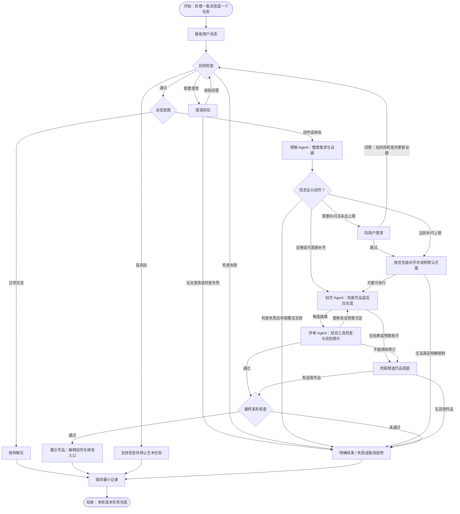

# 墨心智愈 2.0：Agent 项目方案（精简版）

目标：把原项目“识别情绪→查 CSV→出图”升级为能追问、选择工具、调整创作策略并根据结果修订的国画创作 Agent 系统。

## 1. 三个 Agent，分工明确

三个 Agent 可以共用一个支持工具调用的模型，用不同系统提示词、工具权限和结构化输出区分，不需要部署三个模型。第一版新增的陪伴聊天通道也共用这个语言模型服务，用独立提示词与上下文区分；后续再根据回复质量、上下文稳定性和并发时延决定是否专门部署第四个模型。

| Agent | 自主决策 | 可用工具 | 输出 |
|---|---|---|---|
| 理解 Agent | 信息是否足够；是否追问；如何理解用户目标与偏好 | 读取会话证据、请求澄清、更新已确认偏好 | 用户状态、体验目标、风格偏好、限制及证据 ID |
| 创作 Agent | 检索还是生成；选择规则、意象与参数；如何执行修改意见 | 检索规则、检索作品、调用图像生成、读取生成元数据 | 创作纲要、引用、候选作品、执行记录 |
| 评审 Agent | 作品是否符合目标；是否值得修订；指出具体改动 | 读取候选图、读取参数检测结果、查询规则依据 | accept / revise / fallback，失败项与修改建议 |

Agent 的关键是根据状态选择行动和工具，而不是给固定函数换名字。LangGraph 管路由、状态、暂停与次数上限；模型决定具体行动，执行器验证并调用工具。禁止模型通过建议绕过预算、访问权限或发布检查。

理解 Agent 借鉴 AgentMental 的“检查充分性→有限追问→证据更新”，但只询问创作需要的信息，不搬入完整抑郁量表访谈。
### 1.1 AgentMental 机制的任务化适配

借鉴 AgentMental 多智能体框架的“提问—信息充分性评估—证据更新”机制，作为理解 Agent 内部的独立检查步骤，继续由 LangGraph 编排。AgentMental 是框架而非专用模型权重；第一版不直接搬入其完整量表访谈、评分流程或 AutoGen 运行框架，不增加新的模型部署。充分性检查与陪伴聊天、三个 Agent 共用语言模型服务，用独立提示词、上下文和权限区分。

该检查判断“当前信息是否足以开始创作”，不要求完全理解用户心理。它与出图后的视觉评审职责分开，也不能替代风险检查。

| 借鉴机制 | 在本项目中的位置与用途 |
|---|---|
| 提问智能体 | 理解 Agent 针对真正影响创作的缺失或冲突生成一个简短问题 |
| 信息充分性评估 | 理解 Agent 提取需求后检查创作意图、关键限制、证据与默认值是否足以形成纲要 |
| 树状记忆 | 按情绪表达、体验目标、艺术偏好、修改要求组织可追溯的用户原话证据 |
| 更新机制 | 新回答替代旧证据时更新需求摘要；未被修改的已确认偏好继续有效 |

充分性检查输出通过 Pydantic 校验，包含 `sufficient`、`missing_items`、`conflicts`、`should_ask`、`question`、`question_type`、`options`、`allow_free_text`、`allow_skip`、`defaults_used`、`evidence_ids`。仅检查创作需要的信息，意象、墨色、留白等可选字段不必全部填满；每次只问最影响结果的问题，不重复询问已有有效证据的内容。

推进规则由执行器控制：

- 尚未确认创作或修改意图时，继续陪伴或简短确认；达到追问上限不能把普通聊天自动转成出图。
- 已确认创作意图且风险检查通过，信息足够或缺失项可用默认值补齐时，直接形成纲要并进入创作。
- 存在影响创作的缺失或冲突且未达上限时，可补问。每个创作任务累计最多补问 2 次，不按字段重新计数，也不因普通聊天而清零。
- 用户跳过或达到上限后，普通偏好缺失采用已确认偏好与默认模板补齐，告知采用的方案并记录默认值。例如“我先按淡墨、疏朗构图和较多留白画一版，再根据你的反馈调整”。不要求用户再次确认才能推进。
- 未解决冲突优先保留明确禁忌；可兼容解释须说明并记录。同级要求无法同时满足时采用用户最近明确表达的要求；若仍无法形成满足明确禁忌和后端能力的方案，说明原因并结束任务，不能无限追问或假装满足。
- 风险不确定或检查失败仍遵守原风险流程，不能用艺术默认值放行。充分性服务超时或输出非法也不能当作“信息足够”；仅允许一次格式修复或重试，仍失败则显式报错并提供重试入口，不反复追问用户。

界面区分“等待回答”“准备创作”“正在生成”和“失败/结束”。已提交任务独立推进，陪伴聊天不阻塞生成；未回复时保持明确的等待状态并提供跳过入口，任务达到既有总超时则结束，不静默停留在聊天状态。

资料：[AgentMental 官方仓库](https://github.com/MindIntLab-HFUT/AgentMental)、[追问与充分性检查流程](https://github.com/MindIntLab-HFUT/AgentMental/blob/main/src/assessment.py)。借鉴的是交互与记忆机制，不将其量表评分实验结果视为本项目创作质量或疗效的验证。

### 1.2 V1：选择题形式的创作追问

V1 即采用选择题降低回答负担：创作澄清优先使用简短单选题，每次聚焦一个问题，提供 2–4 个有实际差异的选项，同时允许自由输入和跳过。选择题用于创作目标与画面偏好，不强制用户用固定选项描述情绪，也不改变风险检查规则。

- 不预选答案，不标注“推荐”，不把未回答视为选择；避免带评价的措辞暗示某个答案更好。用户点击并确认选项或提交自由文本后才计为回答。
- 记录题目、展示选项与实际回答的对应关系，绑定来源消息作为证据；未选选项不能记为用户偏好。自由输入走同样的风险检查与证据更新流程；用户可纠正此前回答，仅使被替代证据失效。
- 保持每个创作任务最多两次补问，不因问题形式或自由输入增加次数。已确认创作意图且风险检查通过后，跳过或达到上限仍按现有默认方案规则推进。

示例：

> 这幅画你更希望呈现哪种氛围？  
> A. 安静疏朗  
> B. 明亮有生机  
> C. 更贴近此刻的感受  
> 也可以自己描述，或跳过。

追问契约：`question_type` 为 `single_choice` 或 `free_text`；`question` 为题目；`options` 为含稳定 ID 与展示文本的选项列表，单选题为 2–4 项，自由文本题为空列表；`allow_free_text` 与 `allow_skip` 在创作澄清中均为 true。不设置默认选中值。实际回答单独记录选择 ID 或自由文本，跳过记录为跳过事件而非偏好。执行器校验选项与回答匹配，并沿用现有结构化输出失败处理，不把非法或空回答自动映射到首项。

## 2. 整体流程

```text
用户输入
  ↓
风险检查（独立于三个 Agent；失败或不确定不能默认放行）
  ↓
理解 Agent → 创作信息充分性检查 ←→ 用户澄清（每任务最多补问 2 次，可跳过；普通偏好缺失可用默认值推进）
  ↓
创作 Agent → 检索规则/作品 → 选择已有作品或生成
  ↓
评审 Agent
  ├─ accept → 发布
  ├─ revise → 修改建议 → 创作 Agent（最多修订 2 次）
  └─ fallback / 预算耗尽 → 精选作品；没有合适作品则结束
```

候选图在评审前不展示。所有生成都计入最多 3 次的总预算，安全失败也不例外。高风险输入立即进入支持信息界面，停止艺术任务；没有真实人工渠道时不显示“已转介”。

### LangGraph Node 图（简化视图）

图中展示逻辑阶段，方便理解；实现时各阶段仍可拆成模型节点、工具执行与校验节点。充分性检查放在理解阶段，工具循环放在创作阶段，异常处理统一在图下说明。陪伴聊天与创作任务分开调度，不必等待出图完成。



“结束”表示本轮消息处理或当前创作任务结束，不表示关闭聊天。用户可以继续发送消息；明确的修改请求关联原作品并从“开始”建立新任务。风险澄清仍受既有总超时限制；任何阶段的取消或总超时都进入“明确结束”，不再发布作品。

**主线：** 风险检查 → 确认消息意图 → 理解需求 → 创作 → 评审 → 展示与解释。只有明确的创作或修改请求进入创作主线；日常交流留在陪伴通道。后台任务进行中，新的普通聊天消息仍可正常回应，不重新出图。

**两个回环：** 理解阶段最多补问 2 次；评审阶段最多修订 2 次，所有生成累计最多 3 次。发布后的用户修改建立关联原作品的新任务，重新设置预算，不重开已完成任务。次数由执行器检查，模型不能自行放行。

| 阶段 | 图中省略但实现必须保留的规则 |
|---|---|
| 风险检查与澄清 | 每条新消息和澄清回答先过风险检查；未解决风险不能因跳过或达到创作补问上限而放行。高风险进入支持流程，检查失败或无法澄清时明确结束 |
| 理解与默认方案 | 更新证据、维护累计补问次数；已确认创作后，跳过或达到上限时按优先级补齐普通偏好。方案无法满足明确禁忌或后端能力时说明原因并结束；检查服务失败不能假定信息充分 |
| 创作与工具执行 | 执行器校验工具权限和参数；工具结果反馈给创作 Agent。检索、生成都受次数、时间和费用限制；无结果或预算耗尽时进入兜底 |
| 评审与展示 | 候选先做文件、参数与内容检查，再交视觉评审；修订建议写入任务状态。生成作品和精选作品都经过最终发布检查，核查失败不展示 |
| 结束与记录 | 无适用兜底作品、取消或总超时都明确结束。支持、失败、取消与成功均保存最小任务记录；高风险消息停止艺术任务并抑制后续发布 |

### 2.1 发布后继续修改

发布作品后，用户仍可提出修改，例如“山少一点”“颜色暖一点”或“保留这张，只改成清晨”。系统区分两种回环：

| 回环 | 发起者 | 预算与处理 |
|---|---|---|
| 自动评审修订 | 评审 Agent | 在当前任务内执行，所有生成仍累计最多 3 次 |
| 发布后修改 | 用户 | 新建修改任务，关联原作品；重新设置任务预算，所有生成仍累计最多 3 次 |

修改任务流程：用户修改意见 → 风险检查 → 理解 Agent 读取原作品、已确认偏好与新要求 → 必要时澄清 → 创作 Agent → 评审与发布。原任务保留完成状态，不重新打开；新任务遵守同样的追问、修订、超时和发布限制。

在状态中增加 `parent_artifact_id` 和 `revision_request`：前者指向用户希望修改的已发布作品，后者记录具体修改内容及需要保留的部分。普通首次创作时两者为空。用户明确说“重新创作”时，按新创作任务处理，不强制继承原作品的构图或意象。

理解 Agent 将新要求与旧证据合并：未被修改的已确认偏好继续有效，被新要求替代的证据标为失效。发布记录保存新旧作品的关联，用户可查看原作品和修改结果，避免每轮都从头出图或丢失已确认偏好。

### 2.2 持续陪伴聊天与后台创作

第一版即提供持续的日常情绪陪伴，并在作品完成后解释创作、接收修改意见。用户面对同一个聊天入口；内部保留理解、创作、评审三个 Agent，并增加独立的陪伴聊天通道，与后台创作任务并行。

```text
用户消息 → 风险检查
              ├─ 陪伴聊天 → 及时回应 / 持续日常交流
              └─ 创作或修改请求 → 理解 → 后台创作 → 评审 → 发布
                                                        ↓
                            简短完成提示 → 作品解释 → 接收反馈或修改
```

- 先回应用户，再按需要确认创作需求并提交后台任务。生成期间可以继续聊天；普通聊天不触发出图，不覆盖已确认偏好，也不改变正在执行的创作纲要。
- 聊天上下文与创作任务状态分别维护。生成开始时保存创作纲要版本；新要求作为待处理修改记录，不悄悄改动当前任务。陪伴聊天通道不能直接调用出图工具，创作与修改仍交给已有 Agent 流程处理。
- 作品通过评审和发布检查后显示简短完成提示。用户正在表达重要感受时，先继续回应当前话题，避免用长篇作品解释抢占对话；在适当时机或用户查看作品后介绍画面。
- 解释必须依据实际已发布画面、已确认需求与创作记录，说明采用的意象、色调、构图及其与需求的关系。未实现的目标不能声称已实现，不把艺术选择说成已证实的疗效，也不通过画面反推用户心理状态。
- 区分体验反馈（如“看着舒服”）、修改请求（如“竹子少一点”）和结束意图（如“先不改了”）。修改请求沿用 2.1 的新任务与作品关联机制；仅有文生图能力时明确说明会重新生成，不承诺保留原构图或局部编辑。
- 每条新聊天消息仍经过风险检查。出现高风险输入时进入已有支持流程，停止艺术任务并抑制其后续发布；若后端不能立即取消，记录取消状态，待返回后不展示结果。已提交生成仍计入原任务预算，普通聊天不额外消耗生成次数。

第一版的陪伴聊天与三个 Agent **共用一个语言模型服务**，通过不同系统提示词、独立上下文与工具权限区分职责，不额外部署第四个模型。共用服务不保证同一显卡能高效并发：后台队列与聊天调度分开管理，实测生成期间的回复时延，不把长时间出图放在阻塞聊天的执行路径上。

后续版本根据陪伴回复质量、上下文稳定性与并发时延评估，决定是否为陪伴功能单独部署第四个模型。该模型专门承担持续聊天与作品解释，不替代理解、创作或评审模块；其修改意图仍通过既有创作流程执行。

## 3. 状态与记忆：够用就好

共享状态只保留：`goal`、`preferences`、`evidence`、`art_brief`、`candidate`、`review`、`attempts`、`budget`、`status`，以及发布后修改所需的 `parent_artifact_id`、`revision_request`，以及创作推进所需的 `creation_intent_confirmed`、`clarification_count`、`adequacy`。

会话记忆用 SQLite 或 JSON，借鉴 AgentMental 的树结构：

```text
会话
  ├─ 目标：舒缓 / 表达 / 振奋
  ├─ 偏好：墨色、留白、意象
  └─ 证据：用户原话片段、是否确认、是否被新回答替代
```

记忆按“会话 → 情绪表达 / 体验目标 / 艺术偏好 / 修改要求 → 原话证据”组织，各证据记录来源消息、确认状态与替代关系。情绪表达供陪伴理解，只有明确创作要求或已确认偏好才更新纲要；默认值单独记录，不能伪装成用户原话。用户修改后，仅被新要求替代的旧证据标为失效并重建纲要。第一版只做会话内记忆，默认不长期保存完整对话，不上向量库。

用户情绪、体验目标、艺术风格分开存。保留原五类情绪作为参考，允许混合或未知；六轴暂作可选艺术标签，不强制从文本预测，也不由六轴计算情绪强度。

创作约束优先级：用户明确禁忌与偏好 → 用户确认的体验目标 → 当前创作需求 → 情绪推断与默认模板。情绪只辅助理解，不直接决定画面，也不覆盖用户选择。例如用户表示焦虑但希望看到明亮春景，应按明亮春景创作，不自动套用冷灰色调。用户明确要求之间有冲突时，由理解 Agent 简短澄清，不自行用情绪判断替用户决定。

## 4. 技术栈与复用

| 部分 | 先用什么 |
|---|---|
| 编排 | LangGraph：状态、条件路由、追问暂停、评审回环 |
| Agent 模型 | 优先 qwen3.5-plus API；本地候选 Qwen3.5-9B，轻量备选 Qwen3.5-4B；三个 Agent 共用模型、分开提示词和工具权限 |
| 契约 | Pydantic 校验工具参数和结构化输出，非法调用拒绝并显式报错 |
| 图像 | 现有 WebUI + SDXL + 山水 LoRA，先验证兼容性与效果 |
| 映射 | 原 CSV 转规则 JSON，补适用目标、参数和可核查来源 |
| 前端 | 先保留 Streamlit，支持持续聊天、后台任务状态查询、作品完成提示、创作解释与修改反馈 |
| 存储 | SQLite 任务与证据记录，文件目录保存候选和发布作品；聊天上下文与创作任务状态分别维护 |

直接复用：`run_pipeline.py` 的图像/音乐接口思路、`prompt_selector.py` 的模板内容、日志字段、案例归档。先修硬编码路径和随机性，生成必须记录 seed、模型、LoRA 与参数。

旧情绪模型作为对照，不承担新 Agent 的工具规划。无需先训练 LoRA，也无需同时切换 ComfyUI、新图像模型和前端。

第一版将图像生成改为后台任务，Streamlit 独立处理聊天消息、查询任务状态与展示已发布作品；避免在聊天执行路径中用同步等待阻塞整个生成流程。FastAPI + SSE 放在需要独立网页或多人访问时再接；音乐先选授权素材或保留原接口为可选工具，不阻塞图像主线。

### 4.1 Agent 模型选型

当前建议：**效率优先选 API，需离线再选本地；先不微调。** 下列模型是候选，不是已经在本项目验证的最佳模型。选择依据是工具调用、图像输入和可接入性，不依据“心理领域”名称。

| 候选 | 用途与优势 | 注意事项 |
|---|---|---|
| **qwen3.5-plus（API 首选）** | 官方服务支持文本/图像理解与 Function Calling；理解、创作、评审共用一个服务，省去本地 Agent 显存占用 | 需账号、API Key 和费用预算；调用前确认所在地域的模型权限，测试图像和工具调用；实验记录具体模型版本 |
| **Qwen3.5-9B（本地首选）** | 开放权重、多模态、工具调用；可同时承担语言规划和看图评审 | Windows 先测试 Ollama 的 `qwen3.5:9b`；量化、上下文和图片都会影响资源占用，与 SDXL 同时运行需实测 |
| **Qwen3.5-4B（轻量备选）** | 同系列多模态模型，Ollama 提供 `qwen3.5:4b`；适合低资源情况下验证流程 | 不默认认为复杂工具规划和审美评审可靠；通过同一小测试集后才替代 9B |

模型服务统一封装为 `AgentModelClient`，支持文本、图片、工具调用及结构化响应。LangGraph 继续负责三个 Agent 的编排，不额外叠加另一套 Agent 框架。不同服务的图片格式、工具返回和思考开关在客户端适配；先测试关闭思考以减少时延，不直接照搬各服务的参数名。

先做 20–30 个中文冒烟案例：明确目标、目标缺失、偏好冲突、用户纠正、无需生成、工具失败、图片与纲要不符。检查四件事：工具选对、参数合法、能在限制内结束、评审确实接收图片。仅凭提示词或生成元数据评分不能算视觉评审。

若一次格式修复后仍失败，任务显式降级，不无限问模型；若视觉评审与人工经常冲突，先人工确认，不立即增加模型规模。

资料：[Qwen3.5-9B 模型卡](https://huggingface.co/Qwen/Qwen3.5-9B)、[4B 模型卡](https://huggingface.co/Qwen/Qwen3.5-4B)、[qwen3.5-plus 服务说明](https://help.aliyun.com/en/model-studio/qwen3-5-plus)、[Ollama 9B](https://ollama.com/library/qwen3.5:9b)、[Ollama 4B](https://ollama.com/library/qwen3.5:4b)。查询日期：2026-10-12；价格、可用地域与运行环境以接入时确认结果为准。

### 4.2 图像模型更换计划

**Agent 模型负责决策，图像模型负责出图。** 三个 Agent 和 Node 图不随图像底模改变；`creation_tools` 通过适配器调用不同后端。

```text
create_agent → generate_image(art_brief, render_options)
                     ├─ SDXLAdapter → 现有 WebUI
                     ├─ ZImageAdapter → 独立 Diffusers 推理服务
                     └─ QwenImageAdapter → 独立 Diffusers 推理服务
```

统一接口现在就定好：

- 输入：纲要（意象、构图、留白/墨色/设色目标）、尺寸、seed、后端名、预算。Agent 不直接传任意采样器或模型路径。
- 输出：候选资源 ID、实际 seed、模型版本、实际参数、耗时、错误类型；远端异步后端再加 task_id。
- 后端各自把纲要转换为提示词并校验支持的参数。不支持的控制项明确返回，不能假装执行；固定 seed 只能帮助同后端重跑，不能让不同模型生成同一张图。

| 阶段 | 接入方式 | 需要重做的部分 | 保留的部分 |
|---|---|---|---|
| **现在：SDXL + 山水 LoRA** | 封装现有 `/sdapi/v1/txt2img`，明确底模与 LoRA，记录真实参数 | 修路径、补 seed、检查 LoRA 触发词和许可 | 现有 WebUI 与模板资产 |
| **后续 1：Z-Image-Turbo** | 新建独立推理环境，用 Diffusers 跑通单图，再包成同接口服务；定位为快速迭代候选 | 水墨提示词、风格测试、参数响应标定；不加载旧 SDXL LoRA | Agent、纲要、记忆、工具契约、回环 |
| **后续 2：Qwen-Image-2512** | 同样单独环境与适配器；资源不足则用远端 GPU 服务，实际提供商另行确认 | 模型专属提示词、资源配置、参数响应和评审阈值校准 | 同一批测试纲要与 Agent 流程 |

Z-Image-Turbo 官方示例为 9 个推理步设置（8 次模型前向），`guidance_scale=0`；官方称可在 16 GB 显存设备运行，但不代表能与本地 Agent 同时常驻。Qwen-Image-2512 官方示例使用 50 步和 `true_cfg_scale=4`，只能作为起点，不保证本机速度。两者参数不能套用 SDXL 配置；先不追加未经验证的 shift 或量化建议。

每次只增加一个后端：固定 10–20 个纲要，每个多个 seed；同分辨率比较，再按各模型推荐设置补测。记录国画风格、目标符合度、控制响应、生成/完整回环耗时、显存和费用。新模型确有收益才设为默认，SDXL 留作对照；不预设 Qwen 一定更好，也不预设 Turbo 一定更可控。

资料：[Z-Image-Turbo 官方模型卡](https://huggingface.co/Tongyi-MAI/Z-Image-Turbo)、[Qwen-Image-2512 官方模型卡](https://huggingface.co/Qwen/Qwen-Image-2512)。

## 5. 创作与评审怎么落地

创作 Agent 先检索规则，再按用户目标选作品或生成。每条规则带 ID、适用条件、艺术参数和来源；没有来源的规则标为设计启发式，不能让模型编造画论引用。先用结构化过滤，不急着建知识图谱。

第一版控制留白、墨色、设色三个参数。它们是生成目标，不保证提示词能精确实现；固定 seed 测几个档位，看画面是否按预期变化。滑块松开后重生成，不承诺实时改画。

评审结合两类信息：

- 工具检查：文件有效性、尺寸、可验证的留白/色彩特征，以及可用的内容检查能力。
- 视觉模型判断：目标符合度、明显构图问题、风格偏离；输出具体修改意见并绑定证据。

视觉评审先用人工评分校准，不能把模型自评直接当可靠标准。只在有可执行改动时回炉，例如“减少高饱和色块”，不接受“再画得更好”这类空泛意见。模型只建议放行，最终发布仍通过程序检查。无法可靠自动检查的输出，试验阶段加入人工确认。

## 6. 项目推进顺序：按步骤验收

先完成 **Agent + SDXL**，再升级图像后端。原型按约 4–6 周安排，后续模型迁移单独排期；以下时间是开发预算，模型下载、硬件排障和授权获取另计。

| 顺序 | 做什么 | 具体操作与产物 | 完成判据 |
|---|---|---|---|
| **1 · 盘点环境** | 确认能跑什么 | 检查 GPU/显存、Python、WebUI、模型文件；确定 API 或本地 Agent 路径，建立独立 v2 环境 | 一页配置清单与依赖记录，不以“文件存在”当“已经可用” |
| **2 · 打通图像工具** | 先让旧后端稳定出图 | 修硬编码路径，WebUI 开 API；明确 SDXL 底模与 LoRA，固定 seed 出一组图；封装 `SDXLAdapter` | 返回图片及真实元数据；错误、超时能明确返回 |
| **3 · 定状态和工具契约** | 让后续换模型不改 Agent | 写 `schemas.py`、工具白名单与三个 Agent 的权限；定义 `AgentModelClient`、图像接口和预算字段 | 合法请求可执行，非法字段/越界参数被拒绝 |
| **4 · 跑 mock Node 图** | 验证路由，暂不接真实模型 | mock Agent 决策与工具结果；覆盖追问、跳过、修订、失败、兜底、取消 | 无无限循环，最多两次补问/三次出图，候选不提前公开 |
| **5 · 接 Agent 模型** | 选定一个服务 | API 先测试 qwen3.5-plus；本地先测试 9B，不够再测试 4B；跑 20–30 个工具与图像冒烟案例 | 工具调用、图片输入、格式校验可用，记录失误与时延再选型 |
| **6 · 完成理解 Agent** | 澄清目标并维护证据 | 实现 `ask_user` 暂停/恢复、AgentMental 式充分性检查、V1 单选追问与自由输入/跳过、SQLite 证据记忆和偏好纠正；记录题目选项及实际回答、创作意图、累计补问次数与默认方案；新回答先过风险检查 | 选项不预选且无推荐标记；点击确认、自由输入、跳过和用户纠正均可用；不重复问已确认内容，仅替代证据失效；确认创作后跳过或两次补问仍模糊可默认推进；普通聊天不出图；检查故障显式返回 |
| **7 · 完成创作 Agent** | 能自己选择工具 | 原 CSV 转规则 JSON；准备约 10–20 件可用精选作品；接检索与 SDXL 工具 | 可演示“直接检索”“缺信息补问后生成”，理由引用真实规则 ID |
| **8 · 完成评审回环** | 让修改意见真正生效 | 图像实际传给评审模型；加入文件/参数检查；修改意见回到创作 Agent；实现发布与兜底 | 能展示一次有明确修改的回炉；失败/耗尽能结束，不按成功归档 |
| **9 · 完成原型与基线** | 固定当前版本并接持续陪伴 | 共用语言模型服务，分开陪伴提示词与上下文；图像作为后台任务，Streamlit 独立处理聊天与状态查询；加入完成提示、实际画面解释与修改意图分流；冻结案例、模型和配置，导出运行记录 | 生成期间可聊天，普通聊天不重复出图；完成提示不抢占话题，解释符合实际画面，修改关联正确作品；同一版本可重跑，完整记录成功、失败、耗时、费用 |
| **10 · 接 Z-Image-Turbo** | 在接口不变的前提下增后端 | 新环境跑单图→实现 `ZImageAdapter`→专属提示词→三个控制档位测试→同案例对比 | 仅改后端配置即可调用；LoRA/参数不误用；确定是否值得设默认 |
| **11 · 接 Qwen-Image-2512** | 测试质量候选 | 检查内存/显存或远端资源→实现 `QwenImageAdapter`→单图→参数标定→同预算质量对比 | 明确实际质量、时间和成本，再决定主模型或可选模式 |
| **12 · 做最小实验** | 验证 Agent 的收益 | 先固定图像后端比较 Agent 机制，再固定 Agent 比较三个图像后端；使用人工盲评与等预算重抽对照 | 能说明改进来自追问/记忆/评审还是图像底模，报告负结果 |

推荐节奏：第 1 周完成 1–4；第 2 周完成 5–6；第 3 周完成 7–8；第 4 周完成 9 与 SDXL 小对照。第 5–6 周处理失败案例与基础参数标定；随后按资源接 10–11，并在各阶段持续采集第 12 步数据。

建议最小目录：

```text
v2/
  schemas.py / config.py / graph.py
  agents/understand.py / create.py / review.py
  clients/agent_model.py
  tools/retrieve.py / inspect.py
  backends/sdxl.py / z_image.py / qwen_image.py
  memory.py / storage.py
  data/art_rules.json / curated_manifest.json
  ui.py / eval/ / tests/
```

第一批提交先包含 `schemas.py`、配置、SDXL 适配器和 mock 图。API Key 放环境变量，模型名、地址、后端名写配置。预算未知前不下载多个大模型，不把 WebUI、Diffusers 与本地 Agent 的依赖混装在原环境。

## 7. 可行性与最小验证

主要难点不是三 Agent 编排，而是图像控制是否有效、视觉评审是否可靠。先用少量固定案例发现问题，不追求一次铺满六轴、图谱、微调和多模态。

| 风险 | 处理 |
|---|---|
| 模型乱调用工具 | 白名单、严格参数校验、每 Agent 独立权限、有限修复 |
| 追问拖慢体验 | 最多 2 次；可跳过；优先问目标和关键限制 |
| Agent 自评偏高 | 独立人工盲评，并记录未通过和兜底案例 |
| 回炉只是多抽几张图 | 与相同生成次数的随机重抽比较 |
| 本地显存不够 | Agent 用 API；SD 单独运行；不同时常驻大模型 |
| 未找到 600 幅数据 | 不把它当实施前提；小精选库足以验证工具与流程 |

只做三组对照：原固定流水线、带追问/记忆的 Agent、加入评审回环的 Agent；另用等生成预算随机重抽验证回环价值。看目标符合度、用户适配感、重复提问、耗时和调用成本。

V1 选择题追问验收：覆盖选项点击确认、自由输入、跳过与用户纠正；选项无预选或推荐标记，未回答不视为选择，未选项不写入用户偏好；每任务仍最多两次补问；已确认创作且风险检查通过时，跳过或达到上限能记录默认方案并正常推进。

充分性机制验收：明确要求直接创作；“画一幅舒服的画”等模糊创作要求在最多两次补问或跳过后记录默认值并推进；已有偏好不重复询问；普通情绪表达不自动出图；日常聊天不清零补问计数或阻塞后台任务；偏好冲突按优先级处理并说明；风险未解决不放行；服务失败不假定充分。记录重复提问率、默认推进情况与任务停滞情况，沿用现有固定后端对照评估追问和证据记忆的收益。

持续陪伴功能纳入第一版验收：生成期间聊天能正常回复；普通聊天不重复出图或改动当前纲要；作品完成通知不抢占重要话题；创作解释符合实际已发布画面与用户需求；修改请求关联正确作品；高风险新消息能停止艺术任务并阻止后续发布。记录生成期间聊天回复时延与修改意图识别失误，作为后续是否独立部署第四个模型的依据。

最小成果：一个能持续日常情绪陪伴、澄清目标、检索依据、自主选择检索或生成、根据评审修改并有界结束，在作品完成后解释创作与接收修改反馈的 Agent Demo，以及可复核的对照结果。第一版共用一个语言模型服务，独立第四模型留作后续可选升级。

## 8. V2 及以后：可选的降低引导性模块

该模块属于 V2 及以后可选增强，不纳入 V1 开发排期或验收。V1 先落实选择题的中性措辞、无预选和自由回答等交互规则；后续再增加专门的表达检查与改写能力。

模块位于面向用户的回复展示之前，检查追问题目与选项、陪伴回复和创作解释中的引导性表达。它与创作信息充分性检查、风险检查及视觉评审职责分开，不修改用户回答，也不替用户选择或决定创作目标。

| 检查对象 | 关注的问题 |
|---|---|
| 追问与选项 | 暗示“正确答案”、带评价的选项、不对称描述、选项遗漏明显合理选择 |
| 陪伴回复 | 未经确认替用户推断感受，借情绪判断或权威说法推动用户作出某种选择 |
| 创作解释 | 将创作偏好包装成用户应当接受的结论，或用未经证实的效果说法影响用户反馈 |

识别问题后提供更中性的改写，保留原意、用户明确要求、必要的支持信息与风险提示。改写不得弱化既有风险处理或改动任务状态、工具权限与生成预算；含选项的回复应保持选项 ID 与含义对应，无法保持时重新校验后才能展示。检查或改写失败时显式记录并按配置处理，不宣称已经消除引导性。

可先用共用语言模型服务的独立提示词实现，再根据效果决定是否部署专门模型。专门的降低引导性模型与可选的独立陪伴模型是不同职责；不承诺仅增加模型即可消除引导性，也不把“降低倾向性”等同于消除所有偏差。

保存最小必要的原始候选表达、问题标记、改写结果及模型版本记录，沿用项目的会话存储与隐私规则。用人工对比评估表达中立性、原意保持、共情质量、必要风险提示保留及额外时延，记录未改善或改写失真的案例；达到可接受效果后再决定是否启用为默认模块。
